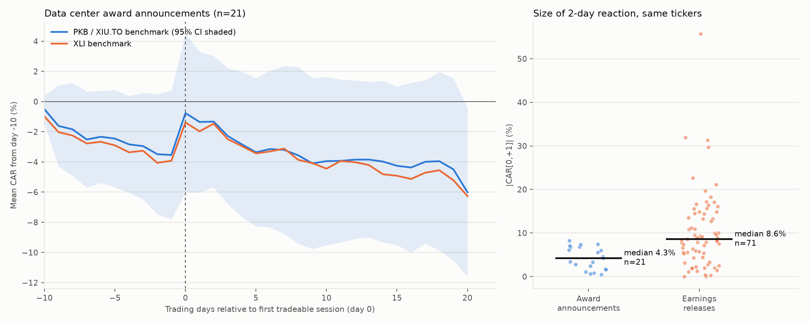
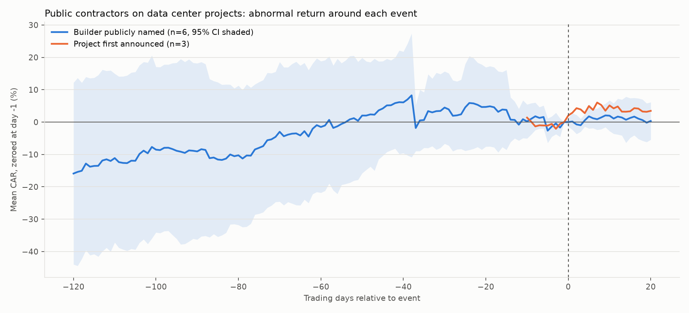

# Data center contract awards: is there a trading signal?

Generated 2026-10-30 by `run.py`. Abnormal returns use a market model: PKB as the benchmark for US
stocks, XIU.TO for Canadian stocks, and XLI as a robustness check. t-statistics are cross-sectional.

## Verdict

No usable signal from individual contract wins.

- **Contractor award releases:** across 21 verified releases, stocks rose about
  +2.2% over two days, and the gain was gone within a week.
  Clean standalone awards show about zero.
- **Who builds data centers:** of 90 large projects, only
  9 had any public builder named. The main builders are private.
- **Earnings day:** earnings moves are about 2.0x larger than award
  moves. If data center activity reaches these stocks at all, it is through backlog reported on earnings day.

## 1. Contractor award announcements

**Sample:** 32 releases found, 5 excluded for
falling within 3 trading days of earnings, 21 analysed.

| Window | Main benchmark | XLI | No same-day news | Standalone only |
|---|---|---|---|---|
| CAR[-1,1] | +2.1% (t=1.82, n=21) | +2.1% (t=1.84, n=21) | +2.6% (t=2.13, n=17) | +1.2% (t=0.41, n=6) |
| CAR[0,1] | +2.2% (t=2.22, n=21) | +2.0% (t=2.00, n=21) | +3.0% (t=2.98, n=17) | +0.1% (t=0.05, n=6) |
| CAR[0,5] | +0.2% (t=0.18, n=21) | +0.5% (t=0.41, n=21) | +0.1% (t=0.06, n=17) | +0.3% (t=0.16, n=6) |
| CAR[0,20] | -2.0% (t=-0.94, n=19) | -1.8% (t=-0.72, n=19) | -2.3% (t=-0.94, n=15) | -2.0% (t=-0.44, n=5) |
| CAR[-10,-1] | -3.5% (t=-1.62, n=21) | -3.9% (t=-1.88, n=21) | -4.1% (t=-1.56, n=17) | -0.2% (t=-0.09, n=6) |

**Deal size:** 6 events disclose a deal value.
- **Regression of CAR[0,+1] on log(deal value / revenue):** slope +0.015,
  p=0.37.
- **Deals above 5% of revenue:** +1.7% average
  (n=2), against +0.5% for smaller deals
  (n=4).

**Earnings comparison (same tickers, last 8 quarters):**

| Event | n | Median 2-day move, ignoring direction |
|---|---|---|
| Earnings releases | 71 | 8.6% |
| Award releases | 21 | 4.3% |

Earnings moves are larger than award moves (Mann-Whitney p=0.0001).

## 2. Predict the location, then the builder

**Question:** if you knew where a data center would be built and which public contractor would build it,
would buying that contractor's stock have paid?

- **Builder named:** 37 of 90 projects have any
  builder publicly named.
- **Public builder:** 9 projects involve a public firm:
  HOT.DE ×4, ORAS.CA ×2, 000720.KS ×1, PRIM ×1, MTZ ×1, MTRX ×1.
- **Private builders seen most often:**
  Yates Construction, DPR Construction, Clayco, Walbridge, Gray Construction, Kiewit, Layton Construction, Hensel Phelps, Haskell, Wages Civil LLC.

| Window | Builder named | Project announced |
|---|---|---|
| CAR[-10,-1] | -0.9% (t=-0.30, n=6) | -1.2% (t=-0.45, n=3) |
| CAR[0,1] | +0.2% (t=0.12, n=6) | +2.9% (t=0.97, n=3) |
| CAR[0,5] | +1.8% (t=0.92, n=6) | +5.0% (t=1.78, n=3) |
| CAR[0,20] | +0.3% (t=0.12, n=6) | +3.5% (t=0.58, n=3) |
| CAR[-60,5] | +2.7% (t=0.24, n=6) | – |
| CAR[-120,5] | +18.9% (t=1.21, n=6) | – |

